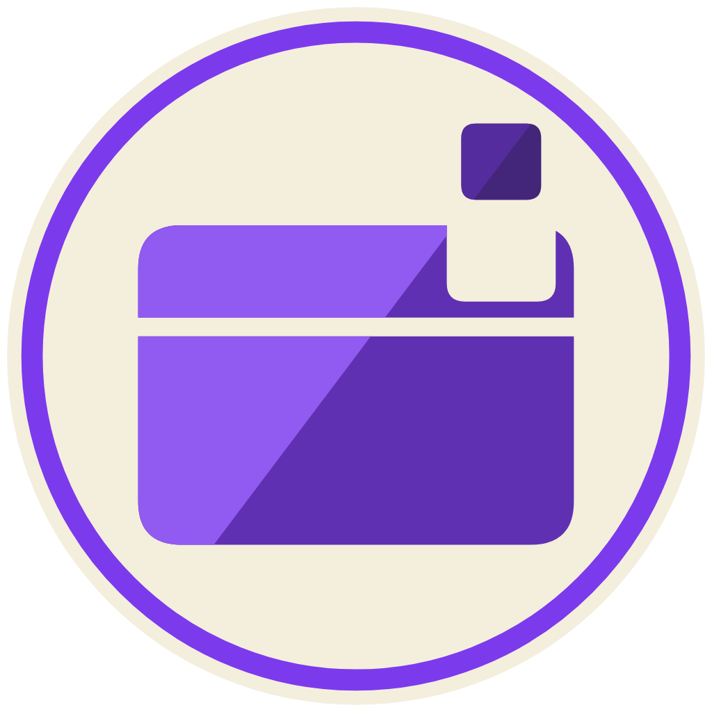
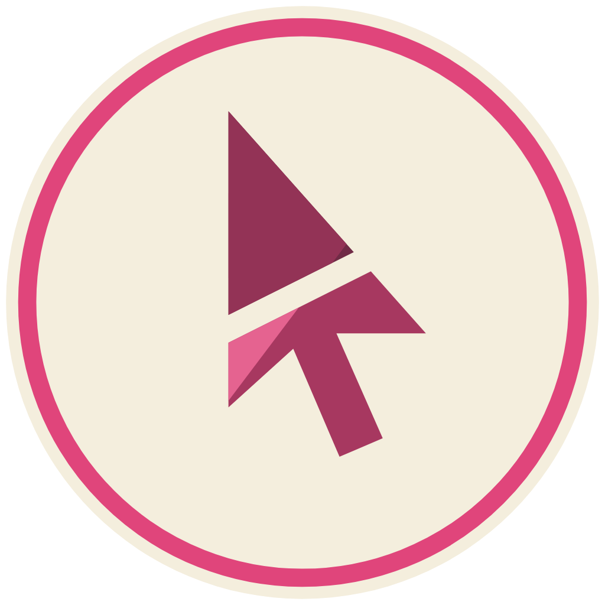
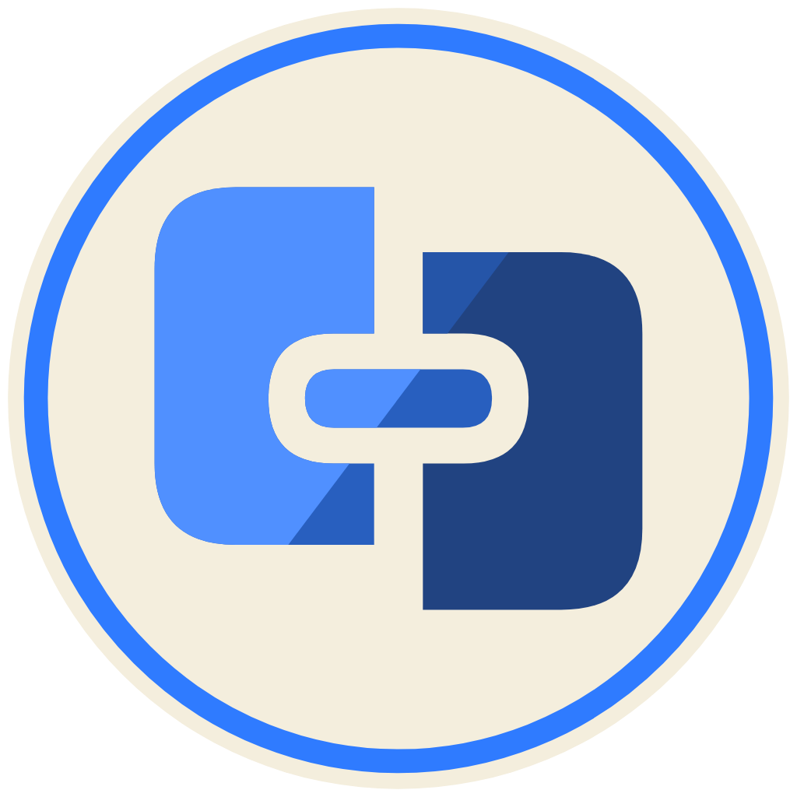
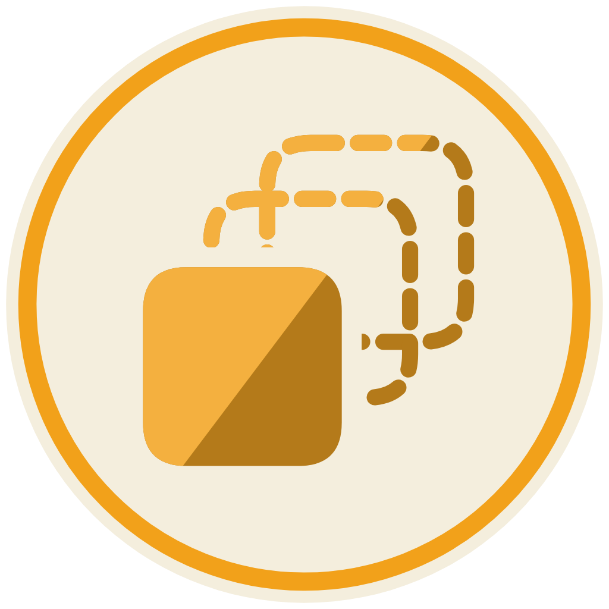
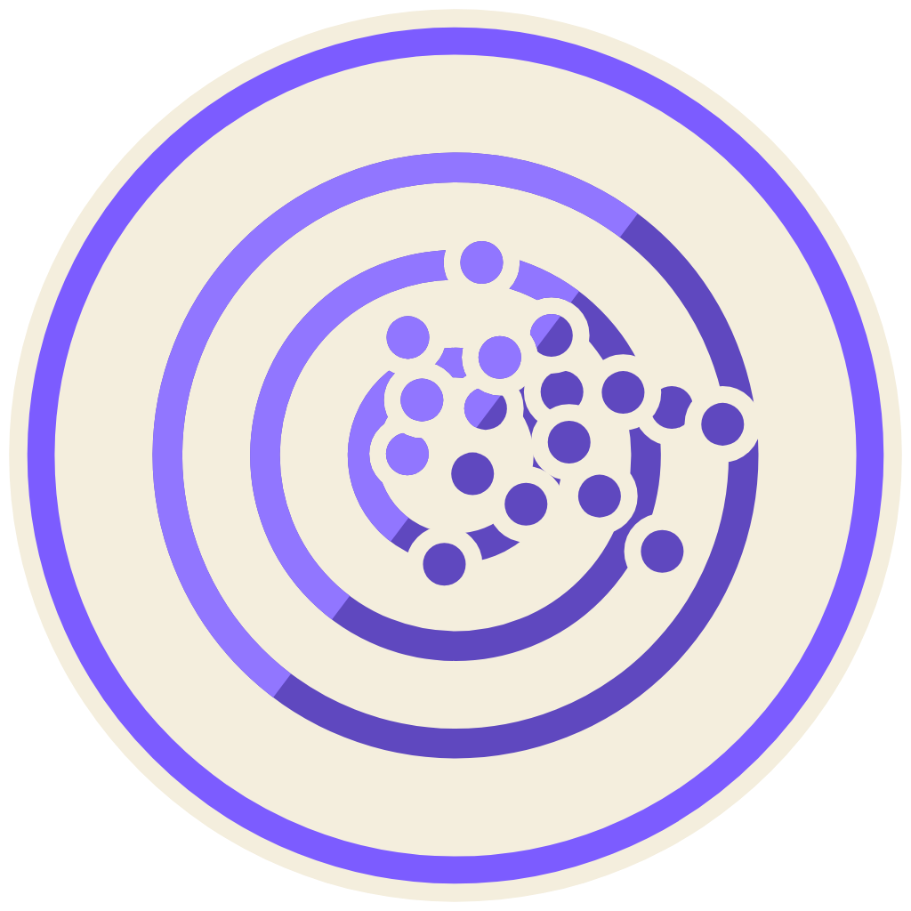
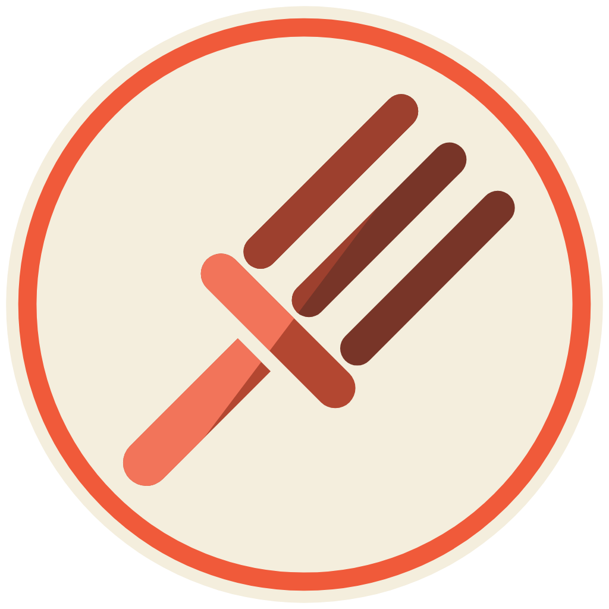
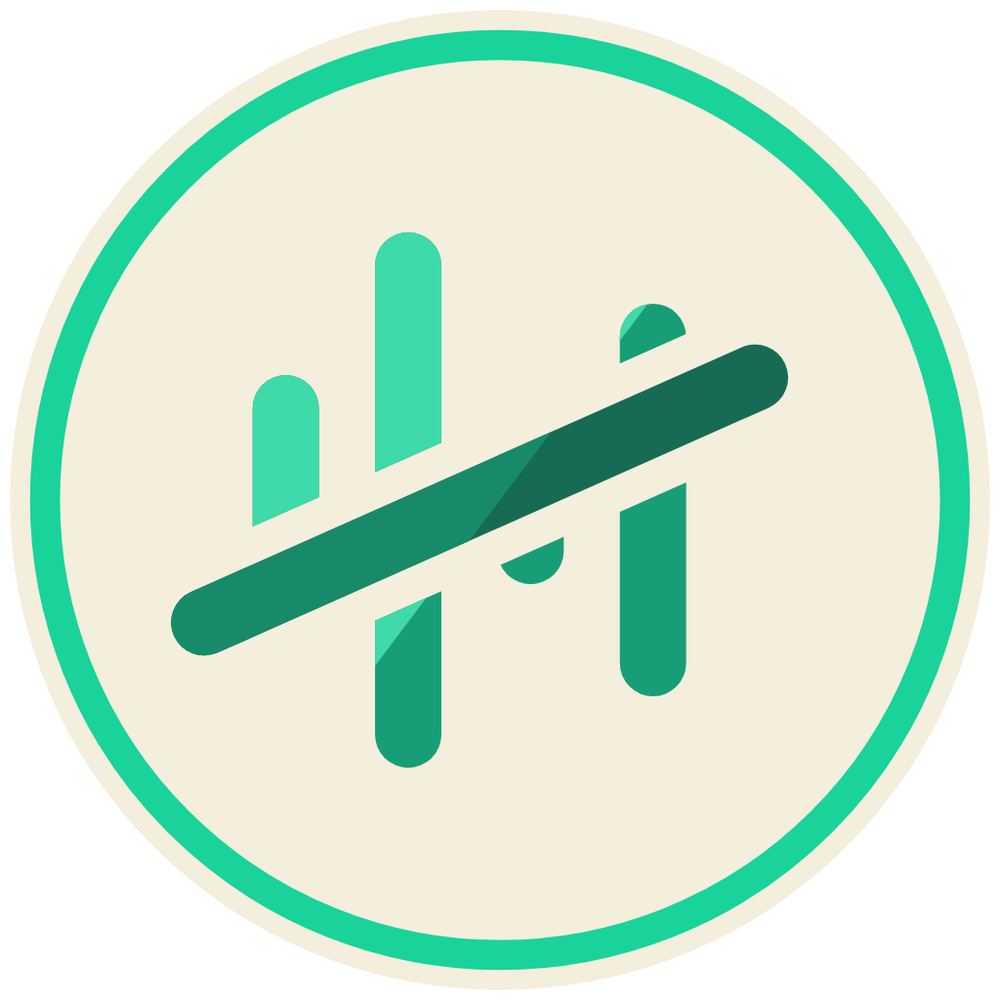

<!-- Generated by scripts/generate-marketplace.ps1 from plugins.json. -->
# 0langa’s Plugins

Plugins I build for my own workflow and share publicly.

**Maintained** plugins are still part of my workflow and receive updates as needed, without a release schedule or support guarantee. **Dormant** plugins remain available as-is, with no planned updates.

Codex and Claude Code are the current clients for maintained plugins. Kimi compatibility is legacy and is not actively tested.

## Maintained plugins

| Plugin | What it does |
|---|---|
|  [Addonry](docs/plugins/addonry/README.md) | Build and test personal Chrome and Firefox extensions. |
|  [Computer Custom](docs/plugins/computer-custom/README.md) | Queue Windows desktop actions with a countdown and shared pause controls. |
|  [RECALL](docs/plugins/recall/README.md) | Keep project decisions and useful context in a local memory store. |
|  [Web.de Access](docs/plugins/webde-access/README.md) | Read, organize, draft, and send mail from your WEB.DE account. |

## Dormant plugins

| Plugin | What it does |
|---|---|
|  [Agent Handoff](docs/plugins/agent-handoff/README.md) | Capture task context and resume it in another coding agent. |
|  [Customization Control](docs/plugins/customization-control/README.md) | Find duplicate customizations and repair local agent configuration. |
|  [Plugin Evaluation Kimi](docs/plugins/plugin-evaluation-kimi/README.md) | Evaluate plugins and skills with static checks and an optional model judge. |
|  [Plugin Forge](docs/plugins/plugin-forge/README.md) | Generate plugin manifests and coordinate releases across coding agents. |
|  [Usage Pulse](docs/plugins/usage-pulse/README.md) | View local reports of your coding-agent activity. |

## Install a plugin

Add the marketplace once, then install the plugin you want. Each plugin page lists its setup and operating-system requirements.

### Codex

```shell
codex plugin marketplace add https://github.com/0langa/plugins.git
codex plugin add recall@0langas-plugins
```

### Claude Code

```shell
claude plugin marketplace add https://github.com/0langa/plugins.git
claude plugin install recall@0langas-plugins
```

Start a new session after installing. Installing this marketplace does not install every plugin.

## Names and existing installations

The repository is `0langa/plugins`; the stable marketplace ID is `0langas-plugins`. Codex displays **0langa’s Plugins**. Claude Code uses the stable ID as its marketplace label. Existing plugin IDs and installation commands remain unchanged.

The previous GitHub repository address redirects here. Existing registrations can continue using that address; use the new address for new installations.

## Legacy Kimi compatibility

The eight Kimi entries remain in `kimi-marketplace.json`. Computer Custom is Codex/Claude-only. Kimi setup is documented on each plugin page and requires a recursive local checkout.

## Project information

- [Development, validation, and publishing](docs/CONTRIBUTING.md)
- [Release history](CHANGELOG.md)
- Report a catalog or installation problem in this repository; report plugin behavior in its source repository. Dormant plugins have no planned fixes.

Individual plugins retain their own licenses. This repository is MIT licensed.
